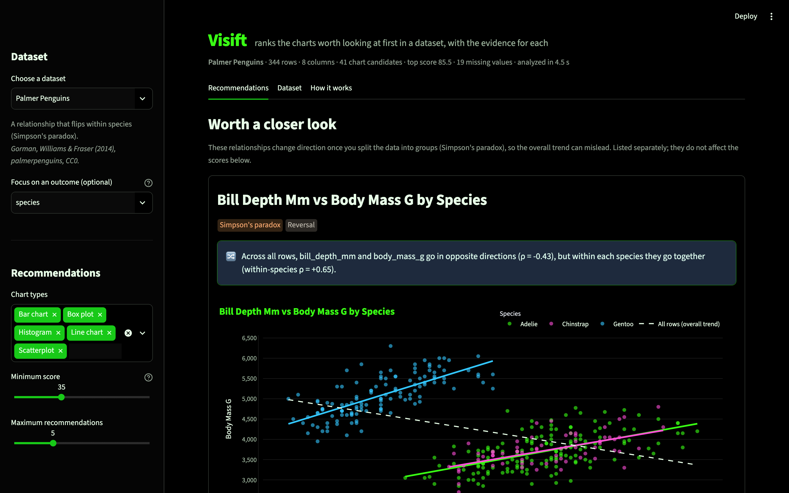
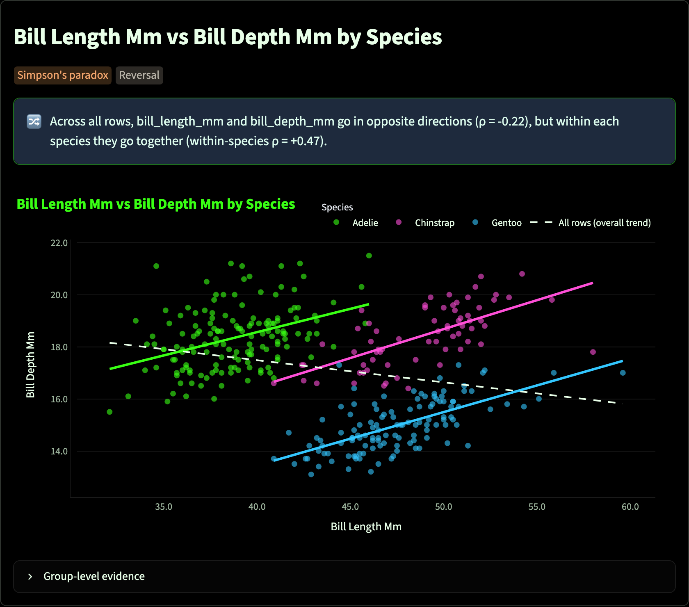

# Visift

[](https://github.com/josh-hu1/Visift/actions/workflows/ci.yml)
[](https://www.python.org/downloads/)
[](LICENSE)
[](https://github.com/astral-sh/ruff)

**Visualization recommendations, ranked by insight.**

Visift is an explainable visualization recommendation engine that automatically profiles a CSV dataset, generates semantically valid chart candidates, scores how informative each visualization is likely to be, and ranks the strongest recommendations.

Instead of showing every chart that *can* be made, Visift prioritizes the charts most likely to reveal useful structure.

**Results so far:** on a small, pre-registered real-world benchmark (4 public datasets, 20 expected insights), Visift puts 95% of the expected insights in its top 10 when you name the outcome you care about, versus 70% for a baseline that sorts the same charts by plain effect size. Without an outcome it is only slightly ahead of that baseline (50% vs 45% in the top 10). Details in [Evaluation](#evaluation).

[Live Demo](https://visift-hq3sfksqtjznd4z8cuutv3.streamlit.app/) · [GitHub Repository](https://github.com/josh-hu1/Visift)

---

## Preview



---

## Why Visift?

Most visualization tools help users build charts after they already know what they want to inspect.

Visift addresses an earlier question:

> **Which visualizations are actually worth looking at first?**

Given a dataset, Visift:

1. profiles each column,
2. infers semantic data types,
3. generates valid visualization candidates,
4. measures chart-specific statistical patterns,
5. scores chart suitability and pattern strength,
6. globally ranks the candidates, and
7. removes redundant views while preserving useful alternatives.

The result is a short, explainable list of recommended visualizations rather than an exhaustive chart gallery.

---

## Features

- **Automatic semantic type inference** for numeric, categorical, ordinal, boolean, geographic, identifier, temporal, datetime, text, and empty fields
- **Five chart types:** scatterplots, line charts, histograms, bar charts, and box plots, plus a dedicated **binary-rate scorer** for outcome-rate bar charts (e.g. survival rate by passenger class)
- **Chart-specific statistical scoring** instead of one generic heuristic
- **Global 0–100 recommendation scores** calibrated across visualization types
- **Pattern-aware explanations** describing why a chart was recommended
- **Alternative-view detection** to avoid ranking redundant charts separately
- **Dataset notes for redundant columns:** near-duplicates (e.g. `temp` and `atemp`, Spearman 0.99) count as one variable, and charts between trivially related columns are set aside with the statistic that explains why instead of topping the ranking
- **Target-aware ranking:** optionally pick an outcome column (Visift suggests one, e.g. a binary `churned` or `y`) to get a "Drivers of <target>" section first; on the real-world benchmark this lifts Recall@10 from 50% to 95% with pre-registered targets (an effect-size baseline reaches 70% in the same setting)
- **Missing-data and sample-size reliability adjustments**
- **Interactive Streamlit interface** with CSV upload, filtering, score breakdowns, and Plotly charts

---

## How It Works

```text
CSV / Dataset
    ↓
1. Data ingestion
    ↓
2. Dataset profiling
    ↓
3. Semantic type inference
    ↓
4. Visualization candidate generation
    ↓
5. Chart-specific pattern scoring
    ↓
6. Global ranking
    ↓
7. Recommendation diversification
    ↓
8. Plotly + Streamlit presentation
```

### 1. Profile

Visift examines:

- pandas data types
- missing values
- cardinality
- numeric distributions
- column names
- observed values

These signals are used to infer how each column should be interpreted.

### 2. Generate

Candidate generation is intentionally permissive. If a visualization is semantically reasonable, Visift creates it as a candidate.

Examples:

- numeric → histogram
- categorical → count bar chart
- numeric + numeric → scatterplot
- temporal + numeric → line chart
- categorical + numeric → mean bar chart and box plot

Generation answers:

> **Can this chart make sense?**

Scoring answers:

> **Is this chart likely to be useful?**

### 3. Score

Each candidate receives two high-level measurements:

- **Chart suitability** — semantic fit, readability, data quality, and sample support
- **Pattern strength** — chart-specific evidence that the visualization contains informative structure

A chart cannot receive a very high recommendation score solely because it is technically valid.

Conceptually:

```text
recommendation score
=
chart suitability
×
pattern-strength adjustment
```

### 4. Rank and Diversify

All supported visualization types compete on a shared 0–100 score.

Visift then groups recommendations using the same variables so that redundant charts do not dominate the final list. The highest-scoring chart becomes the primary recommendation, while other valid views are retained as alternatives.

---

## Chart-Specific Signals

### Scatterplots

Scatterplots evaluate both linear and nonlinear relationships using:

- Pearson correlation
- Spearman correlation
- p-value-based reliability calibration
- mutual information
- permutation-based nonlinear null calibration

This allows Visift to surface strong nonlinear relationships even when ordinary correlation is weak.

### Line Charts

Line charts can detect:

- monotonic trends
- seasonality
- persistent level shifts
- volatility shifts

The temporal scorer also accounts for sample size, missingness, temporal support, and statistical reliability.

### Histograms

Histograms evaluate:

- robust distribution asymmetry
- unusual tail observations
- multimodality

Multimodality is estimated using one- vs. two-component Gaussian mixture models with separation and component-balance checks.

### Bar Charts

Count bars measure meaningful category-frequency imbalance.

Mean bars measure how strongly group membership explains differences in a numeric variable.

### Box Plots

Box plots can be recommended because of:

- differences in group location
- differences in within-group dispersion
- differential outlier behavior

This makes box plots useful for more than simple mean or median comparisons.

---

## Recommendation Scale

| Score | Interpretation |
|---:|---|
| 80–100 | Excellent |
| 65–79 | Strong |
| 50–64 | Moderate |
| 35–49 | Weak |
| <35 | Very weak |

The thresholds and chart-family scoring scales were calibrated using dedicated synthetic evaluation suites.

---

## Evaluation

### Real-world benchmark

Four public datasets, each with **expected insights written down before running Visift on it** (pre-registered in [`expectations.py`](evaluation/real_world/expectations.py); the rule is never to add an expectation because Visift ranked it highly). A recommendation counts if it shows the expected variables with an acceptable chart type. The insights and the outcome column for each dataset were chosen by the same person who built Visift, and there are only 20 of them, so treat these numbers as a small, honest sample rather than a definitive score.

Three rankers see exactly the same candidate charts:

- **Baseline**: sorts charts by one standard effect size (|Spearman ρ|, correlation ratio η, or Cramér's V; single-variable charts last), with no significance tests, calibration, redundancy handling or diversity ([definition](evaluation/real_world/baseline.py), committed before it was run). In target mode it keeps only charts involving the outcome, like an analyst sorting by correlation with it.
- **Visift before Phase 2**: the engine at the end of Phase 1 (commit `4aa4729`), scored against the same answer key. It had no target mode.
- **Visift now**: target-aware ranking, redundancy handling and Simpson's paradox detection.

Headline (all 20 insights; R@k = share of expected insights in the top k, MRR = mean reciprocal rank):

| | Baseline | Visift before Phase 2 | Visift now |
|---|---:|---:|---:|
| No outcome selected: R@3 / R@5 / R@10 | 20% / 25% / 45% | 15% / 25% / 45% | 15% / 30% / 50% |
| No outcome selected: MRR | 0.190 | 0.192 | 0.205 |
| Outcome selected: R@3 / R@5 / R@10 | 40% / 50% / 70% | 15% / 25% / 45% | **50% / 70% / 95%** |
| Outcome selected: MRR | 0.341 | 0.192 | **0.409** |

**Where the baseline holds up:** without an outcome, Visift is barely ahead (R@10 50% vs 45%, MRR 0.205 vs 0.190), and the baseline is better at R@3 (20% vs 15%) and on Palmer Penguins (MRR 0.415 vs 0.394), where the expected insights are strong, simple correlations. Most of Visift's gain comes from target-aware ranking, which turns the question into "what drives this outcome?".

Per dataset (R@3 / R@5 / R@10, MRR):

| Dataset (outcome) | Baseline | Visift before Phase 2 | Visift now |
|---|---|---|---|
| Palmer Penguins, no outcome | 50 / 75 / 100%, 0.415 | 25 / 75 / 100%, 0.394 | 25 / 75 / 100%, 0.394 |
| Palmer Penguins (species) | 50 / 50 / 75%, 0.369 | 25 / 75 / 100%, 0.394* | 50 / 100 / 100%, 0.487 |
| Bike Sharing, no outcome | 0 / 0 / 40%, 0.086 | 0 / 0 / 40%, 0.081 | 0 / 20 / 40%, 0.124 |
| Bike Sharing (cnt) | 40 / 60 / 100%, 0.365 | 0 / 0 / 40%, 0.081* | 60 / 80 / 100%, 0.442 |
| Titanic, no outcome | 40 / 40 / 60%, 0.298 | 40 / 40 / 60%, 0.324 | 40 / 40 / 60%, 0.324 |
| Titanic (survived) | 40 / 40 / 60%, 0.322 | 40 / 40 / 60%, 0.324* | 40 / 40 / 100%, 0.340 |
| Bank Marketing, no outcome | 0 / 0 / 0%, 0.037 | 0 / 0 / 0%, 0.041 | 0 / 0 / 17%, 0.047 |
| Bank Marketing (y) | 33 / 50 / 50%, 0.317 | 0 / 0 / 0%, 0.041* | 50 / 67 / 83%, 0.386 |

\* Before Phase 2 there was no target mode, so the plain ranking is shown for both rows.

Reproduce every number with one command, which also writes [`real_world_comparison.csv`](evaluation/results/real_world_comparison.csv) and the per-insight ranks under [`evaluation/results/`](evaluation/results/):

```bash
python -m evaluation.real_world.download_datasets
python -m evaluation.real_world.benchmark --ranker all
```

**Where it still misses:**

- **Bank Marketing, age vs subscription** ranks 11th even with the outcome selected. The effect is U-shaped (24% of under-25s and 42% of over-60s subscribe, but medians are nearly equal), and the box-plot scorer mostly reads medians and spread. A binned-rate chart would catch it.
- **Bike Sharing, weekday vs workingday** is still in the top 3 without an outcome. `workingday` is determined by `weekday` and `holiday` together, and the redundancy check only looks at one column at a time.
- **Without an outcome, Bank Marketing** finds only 1 of 6 expected insights in the top 10: they are all about the subscription outcome and compete with every unrelated pair.
- **Charts that do not involve the outcome drop in target mode** (Titanic fare by class falls from #1 to #8), by design.

### Calibration and false-positive control (synthetic)

The synthetic suites plant known patterns, so they check calibration and false positives, not accuracy. Retrieving a planted pattern at rank 1 is a sanity check.

| Check | Result |
|---|---:|
| Planted patterns retrieved at rank 1 (95 positive datasets) | 100% (sanity check) |
| Pure-noise candidates scoring ≥ 50 / ≥ 65 (30 null datasets) | 0% / 0% |
| Highest pure-noise score observed | 46.65 |
| Stronger planted pattern wins a cross-chart competition (150 datasets) | 100% |
| Simpson's paradox: planted reversals detected / null datasets flagged | 94.5% / 0 of 320 |

The cross-chart suite also checks that the 0–100 scale means the same thing across chart types (median spread between chart families of 3–9 points per strength tier). Per-family suites for histograms, scatters, grouped charts, time series and binary rates live in [`evaluation/`](evaluation/); outputs go to `evaluation/results/`. One known calibration weakness: the box-plot scorer rates about 4% of pure-noise groupings as "Moderate" (≥ 50), because its spread signal has no significance test.

---

## Simpson's Paradox: "Worth a Closer Look"

Some relationships reverse once you split the data into groups. In Palmer Penguins, longer bills go with *shallower* bills across all penguins (Spearman ρ = −0.22), but with *deeper* bills within every species (pooled within-species ρ = +0.47). Visift checks every numeric pair against up to three grouping columns and lists reversals above the recommendations, with a grouped scatter (one trend line per group plus the dashed overall trend):



A pair is flagged only when the overall and within-group Spearman correlations have opposite signs, both have magnitude ≥ 0.15, both survive a Bonferroni correction over every pair and grouping checked, and groups holding at least two thirds of the rows agree on the within-group direction. The rule was fixed before it was run on real data (and designed knowing the Penguins example). On synthetic data (`python -m evaluation.simpson_calibration`) it detects 94.5% of planted reversals that are visible in the sample and flags none of 320 null datasets; the misses are groups so far apart that x and y become near-duplicates overall, which the redundancy check sets aside. The findings are not scored and do not change any ranking.

---

## Performance

Wall time for the full pipeline (`analyze()`: profiling, candidates, scoring, redundancy checks, ranking), measured with `python -m benchmarks.perf --real-world --jobs 4 --repeats 2` on an 8-core Apple-silicon Mac. Synthetic tables are fixed-seed mixes of numeric, categorical, boolean and date columns.

| Dataset | Columns × rows | Before | After (serial, default) | After (4 warm workers) |
|---|---|---|---|---|
| synthetic | 10 × 2,000 | 1.3 s | 0.6 s | 0.2 s |
| synthetic | 26 × 2,000 | 11.5 s | 3.7 s | 1.6 s |
| synthetic | 50 × 2,000 | 38.8 s | 13.6 s | 5.6 s |
| synthetic | 26 × 10,000 | 11.5 s | 5.5 s | 2.0 s |
| synthetic | 50 × 10,000 | 49.5 s | 18.3 s | 8.3 s |
| Bank Marketing | 16 × 45,211 | 3.9 s | 3.1 s | 2.5 s |

What changed: profiling showed 82% of the time in the scatter scorer's permutation test for mutual information (18 estimator calls per pair). When the observed mutual information is already below the minimum effect size, no permutation result can produce a signal, so those permutations are skipped. This is exact: every score, ranking and benchmark result is unchanged.

Parallel scoring is available (`analyze(df, n_jobs=4)` or `VISIFT_N_JOBS=4`) and gives identical results, but the default is serial: starting worker processes costs several seconds the first time, which is slower than a typical upload on its own. It pays off in a long-running process or for very wide tables. Hosted Streamlit apps reportedly get at most ~2 cores, so the live demo runs serially.

---

## Project Structure

```text
Visift/
├── web_app.py                  # Streamlit UI (streamlit run web_app.py)
├── app.py                      # command-line demo on synthetic_sales.csv
├── pyproject.toml              # package metadata, dependencies, ruff/mypy/pytest config
├── requirements.txt            # Streamlit Cloud entry point: -e .[app]
├── LICENSE                     # MIT
├── .github/workflows/ci.yml    # ruff + mypy, pytest on Python 3.10-3.13
├── synthetic_sales.csv
│
├── tests/                      # pytest suite; fixtures/ holds small CSVs
├── benchmarks/perf.py          # wall-time benchmark (python -m benchmarks.perf)
├── scripts/
│   └── generate_synthetic_sales.py   # regenerates synthetic_sales.csv
│
├── src/visift/                 # the recommendation engine (installable package)
│   ├── types.py                # TypedDict records passed through the pipeline
│   ├── profiler.py
│   ├── semantic_types.py
│   ├── value_normalization.py
│   ├── candidate_generator.py
│   ├── target.py               # target suggestion and drivers-first ranking
│   ├── redundancy.py           # near-duplicate / near-deterministic column pairs
│   ├── paradox.py              # Simpson's paradox detection
│   ├── pipeline.py             # analyze(df, target=None): the whole pipeline in one call
│   ├── scoring/
│   │   ├── engine.py
│   │   ├── bar.py
│   │   ├── binary_rate.py
│   │   ├── box.py
│   │   ├── histogram.py
│   │   ├── line.py
│   │   └── scatter.py
│   └── visualization/
│       └── renderer.py
│
├── evaluation/
│   ├── benchmark.py
│   ├── *_calibration.py
│   ├── real_world/
│   │   ├── benchmark.py
│   │   ├── download_datasets.py
│   │   └── expectations.py
│   └── results/
│
└── assets/
    ├── app-preview.png
    └── simpson-penguins.png
```

---

## Tech Stack

- **Python**
- **pandas**
- **NumPy**
- **SciPy**
- **scikit-learn**
- **Plotly**
- **Streamlit**

---

## Run Locally

Clone the repository:

```bash
git clone https://github.com/josh-hu1/Visift.git
cd Visift
```

Create a virtual environment and install Visift with the Streamlit extra (Python 3.10+):

```bash
python -m venv .venv
source .venv/bin/activate
pip install -r requirements.txt
```

`requirements.txt` installs the `visift` package from `src/` in editable mode. For development tools (ruff, pytest), use `pip install -e ".[app,dev]"` instead.

Launch the Streamlit application:

```bash
streamlit run web_app.py
```

Run the test suite (about 10 seconds):

```bash
pip install -e ".[app,dev]"
pytest --cov
ruff check . && ruff format --check .
mypy                      # type-checks src/visift
```

---

## Using Visift

1. Launch the application or open the live demo.
2. Choose the included sample dataset or upload a CSV.
3. Review the inferred semantic column types.
4. Open the **Recommendations** tab.
5. Inspect globally ranked visualizations and plain-English takeaways.
6. Expand **Recommendation details** for statistical evidence and score components.
7. Filter by chart type, minimum score, or number of recommendations.

---

## Design Principles

Visift was built around several principles:

- **Separate validity from usefulness.** A chart can be appropriate without being informative.
- **Use chart-specific evidence.** Different visualization types reveal different kinds of structure.
- **Account for reliability.** Small samples and missing data should reduce confidence.
- **Prefer effect size plus evidence.** Statistical significance alone should not determine usefulness.
- **Keep weak but valid candidates.** Low-information charts are ranked lower rather than silently removed.
- **Make rankings explainable.** Recommendation scores should be traceable to interpretable components.
- **Evaluate globally.** A score should remain meaningful when different visualization types compete.

---

## Current Limitations

Visift currently focuses on tabular CSV data and five chart types.

Known limitations include:

- irregular temporal sampling can reduce FFT-based seasonality detection
- the [real-world benchmark](evaluation/real_world/README.md) covers only four datasets and 20 expected insights, written by the same person who built Visift
- without an outcome column, ranking is only slightly better than sorting by plain effect size (see [Evaluation](#evaluation))
- relationships that depend on two columns at once (e.g. `workingday` from `weekday` and `holiday`) are not recognized as trivial
- non-monotonic group effects (e.g. a U-shaped rate by age) are underrated by the box-plot scorer
- the box-plot scorer occasionally (about 4% of the time) rates pure noise as "Moderate"
- wide tables are slow: 50 columns take 13–19 s on a laptop
- semantic inference is heuristic and can misclassify ambiguous columns
- high-cardinality or domain-specific visualizations are outside the current scope

---

## Future Work

Potential extensions include:

- additional visualization families
- more robust seasonality detection for irregular time intervals
- more datasets in the [real-world benchmark](evaluation/real_world/README.md)
- user feedback signals for recommendation quality
- domain-aware semantic inference
- richer multivariate visualization recommendations

---

## Author

Built by **Josh Hu**, a Data Science student at the University of California, San Diego.
