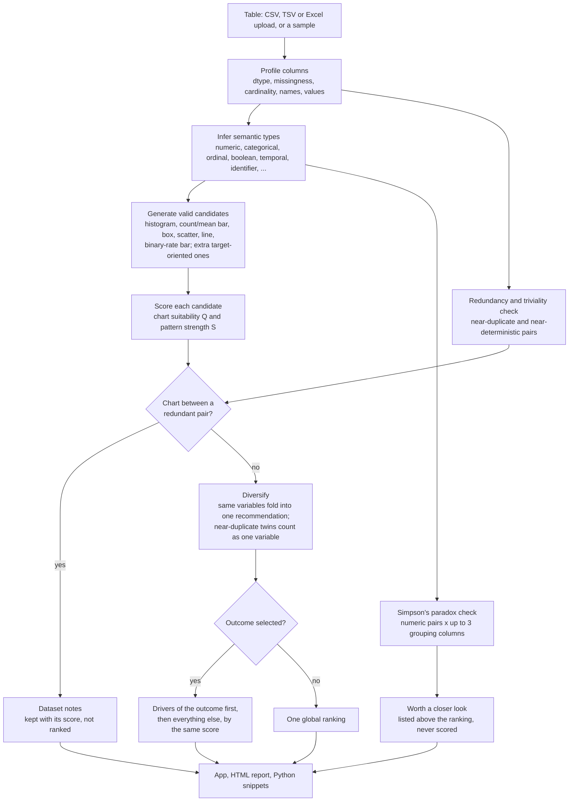

# Visift design doc

How Visift decides which charts to show first, why it is built that way, how it was checked, and where it still fails. Every number here comes from the repository (README, `evaluation/results/`, `benchmarks/perf.py`, the source comments) or from the merged pull requests linked next to it.

---

## 1. Problem and framing

A table with 20 columns supports hundreds of valid charts. Most chart tools answer "which charts *can* I make from these fields?". Visift answers a different question: **which few charts are worth looking at first, and why?**

That splits the problem into two questions that are deliberately kept apart:

- **Validity:** can this chart make sense for these column types? It is answered permissively by the candidate generator.
- **Usefulness:** does this chart show structure that is unlikely to be noise? It is answered by chart-specific statistics, gated on significance and reliability.

A chart that is valid but shows nothing is ranked low, not deleted. Every score can be traced to named components, and the app shows that trace.

Visift also has to work for two kinds of users. One just wants an overview of the dataset. The other already knows the outcome they care about ("what drives churn?"). That second case turned out to be the main lever on the real-world benchmark (section 6).

---

## 2. Pipeline



`visift.pipeline.analyze(df, target=None)` runs all of this in one call. The app, the benchmark and the HTML report all use it, so they can't drift apart.

Some details:

- **Target-aware ranking** (`visift/target.py`) has no boost constant. When an outcome is chosen, every two-variable recommendation that involves it goes into a "Drivers of <outcome>" list. Both lists are ordered by the same calibrated score, so scores stay comparable with and without an outcome. Visift also suggests an outcome from column names (`target`, `label`, `y`, `churned`, `survived`, ...), and the samples preselect theirs.
- **Redundancy and triviality** (`visift/redundancy.py`) catch pairs that are related by construction: `temp` and `atemp`, two encodings of the same contact history, a flag computed from another column. The thresholds were pre-registered:
  - near-duplicate numeric columns: |Spearman| ≥ 0.97;
  - near-duplicate categorical columns: bias-corrected Cramér's V ≥ 0.95, plus determination both ways;
  - categorical → categorical determination: normalized conditional entropy H(Y|X)/H(Y) ≤ 0.05;
  - categorical → numeric determination: η² ≥ 0.95.

  A chart between such a pair is moved to the dataset notes, with the statistic that explains why. Scores are never changed and nothing is deleted.
- **Diversification** folds charts on the same variables into one recommendation. The best-scoring view is the primary one and the others are listed as alternatives.

---

## 3. The score

Every chart family produces the same five components and combines them with one formula (`visift/explain.py`):

```text
chart suitability  Q = 0.30 semantic fit + 0.20 readability + 0.20 data quality + 0.30 sample support
pattern factor       = 0.35 + 0.65 × S / 100         (S = pattern strength, 0–100)
score                = Q × pattern factor
```

**Why multiply and not add?** With a weighted sum, a perfectly valid chart could reach a high score on suitability alone. Multiplying means suitability sets the ceiling and the pattern decides how much of it is reached. A clean, readable chart of pure noise can't look "Strong".

**Why a 0.35 floor?** It keeps weak but valid charts in the list, ranked low rather than removed. It also gives scores a stable meaning: a perfectly suitable chart with no pattern at all scores about 35, the bottom of the "Weak" band (35–49). To climb above it, a chart needs evidence. On 30 synthetic pure-noise datasets, the highest score observed is 43.25, and no noise candidate reaches 50.

**Why these suitability weights?** Semantic fit and sample support carry the most weight (0.30 each) because they decide whether the chart can be trusted at all. Readability and data quality (0.20 each) mostly separate good charts from slightly worse ones.

**The breakdown bar.** Read downward from 100, the score splits exactly into non-negative pieces:

```text
100 = Σ wᵢ (100 − cᵢ)          suitability deductions (sum to 100 − Q)
    + Q × 0.65 × (1 − S/100)   pattern shortfall
    + score                    what remains
```

Each recommendation in the app shows this as one stacked bar, with a sentence underneath: score, then each deduction, then the pattern shortfall. For example, on synthetic sales the #1 chart (Units vs Revenue) has Q = 99.6 and S = 73.5, so the factor is 0.83 and the score is 82.5. The breakdown matches the stored score exactly on all 430 recommendations across the samples ([#15](https://github.com/josh-hu1/Visift/pull/15)).

**Score bands:** 80–100 Excellent, 65–79 Strong, 50–64 Moderate, 35–49 Weak, under 35 Very weak.

---

## 4. Per-family statistics

Each family measures the kind of structure its chart actually shows. Most families turn a p-value into a 0–1 reliability with the same log-linear ramp: full weight at p ≤ 0.001, and linear in log₁₀(p) up to p = 0.10. At p ≥ 0.10 the box, binary-rate and line-volatility signals drop to zero, while correlation keeps a floor of 0.35 and count-bar imbalance a floor of 0.20. A smooth ramp avoids a cliff at any single α.

| Family | Pattern strength measures | Why this statistic | Significance gate |
|---|---|---|---|
| **Scatter** | Pearson and Spearman correlation; symmetric mutual information above a permutation null | Correlation covers linear and monotonic relationships. MI catches nonlinear ones (a U-shape) that correlation misses | Correlation p-value through the ramp, with a floor of 0.35 (significance isn't effect size). MI must exceed both 0.10 and the null mean + 3 SD of 8 permutations, on at most 1,000 rows |
| **Line** | Monotonic trend, seasonality (FFT period confirmed by autocorrelation at that lag), level shifts, volatility shifts | The four things a time-series chart is good at showing | Trend: correlation p-value ramp. Volatility shift: Levene (median-centred) through the ramp. Support for observations and distinct time points |
| **Histogram** | Robust tail asymmetry, unusual tails, multimodality | Moment skewness is dominated by single outliers, so robust quantile asymmetry is the main skew signal | Multimodality needs all three: a BIC gain of 2 Gaussians over 1, component separation and component balance (geometric mean), fitted on at most 2,000 rows |
| **Count bar** | Category-frequency imbalance | A count bar is only interesting when categories are uneven | Chi-square goodness of fit through the ramp (floor 0.20) |
| **Mean bar** | η² (share of variance explained by the groups) | Directly measures "group membership explains the numeric value" | Scaled by √(sample support) so small groups count for less |
| **Binary-rate bar** | Gap in outcome rate across groups (e.g. survival by class), in absolute and relative terms | Means of a 0/1 column are rates; reading them as rates is more honest than η² | Chi-square test of independence through the ramp (zero at p ≥ 0.10); enough minority events per group |
| **Box plot** | Location difference, spread difference (IQR ratio), outlier-rate difference; the maximum of the three | A box plot shows more than medians, so it should get credit for spread and outlier differences too | Each component is gated by its own test: **Kruskal–Wallis** (location), **Brown–Forsythe** (spread, groups ≥ 8 rows), and a **permutation test** of the outlier-rate chi-square (raw values permuted and fences recomputed each time, with Besag–Clifford early stopping after 20 exceedances, up to 999 permutations). Because the signal is a maximum of three, the p-values are **Bonferroni ×3** before the ramp |

The box-plot gates were the only change in this table driven by a measured failure; section 5 has the story.

---

## 5. Calibration and false-positive control

The synthetic suites (`evaluation/*_calibration.py`, results in `evaluation/results/`) plant known patterns at known strengths. They test calibration and false positives, not accuracy: finding a planted pattern at rank 1 is a sanity check.

| Check | Result |
|---|---:|
| Planted patterns retrieved at rank 1 (95 positive datasets) | 100% (sanity check) |
| Pure-noise candidates scoring ≥ 50 / ≥ 65 (30 null datasets) | 0% / 0% |
| Highest pure-noise score observed | 43.25 |
| Stronger planted pattern wins a cross-chart competition (150 datasets) | 100% |
| Median spread between chart families, per strength tier | 1–9 points |
| Simpson's paradox: planted reversals detected / null datasets flagged | 94.5% / 0 of 320 |

**The box-plot story.** In Phase 1, a seeded test showed a pure-noise box plot (4 groups of about 100 N(0,1) rows) scoring "Moderate". Rather than assert on one seed, the test was rewritten to measure the rate across seeds. Over 500 seeds, 4.4% of null box plots scored ≥ 50 (max 55.9, [#3](https://github.com/josh-hu1/Visift/pull/3)). The cause: the spread signal took chance IQR ratios between groups at face value.

Phase 2.6 ([#12](https://github.com/josh-hu1/Visift/pull/12)) measured it properly before fixing it. On the test-suite case, 4.8% of nulls reached ≥ 50. With about 20 rows per group it was far worse: 20.5% for 2 groups, 48.5% for 3, 71% for 5 and 81% for 8. The gates in section 4 were pre-registered (commit `9ce488f`), and that version **failed** its own acceptance criteria (up to 5.0% per cell). Two amendments were then made and disclosed in the code:

1. The pre-registered outlier test permuted 0/1 outlier flags. That is invalid, because each flag depends on its own group's fences, so the flags aren't exchangeable. Under the null it gave p < 0.01 in 3–6% of cases. It now permutes the raw values and recomputes all fences each time.
2. Bonferroni ×3 across the three components, because the signal is their maximum.

After the fix, pure noise reaches ≥ 50 in 0.2% of the standard case and 0.0–1.2% across the grid of 2–8 groups of 20 or 100 rows (500 seeds each). One cell (5×20) stays at 1.2%, narrowly missing the "≤ 1% everywhere" criterion. That miss was reported in the PR, not tuned away. The hardened benchmark still retrieves 100% at top-1, 3 and 5, and its highest null score fell from 46.65 to 43.25.

The cost is power on very small groups. With 2 groups of 20 rows, genuine spread differences are detected far less often (see [#12](https://github.com/josh-hu1/Visift/pull/12) for the full table). Before the fix, those detections sat on top of a 20–81% noise rate, so they weren't worth much.

**Simpson's paradox rule.** A pair is flagged only when all four conditions hold:

- the overall and within-group Spearman correlations have opposite signs;
- both have magnitude ≥ 0.15;
- both survive Bonferroni over every pair and grouping checked;
- groups holding at least two thirds of the rows agree on the within-group direction.

The rule was fixed before it was run on real data. It was designed knowing the Penguins example: bill length vs bill depth has ρ = −0.22 overall and +0.47 within species. Paradox findings are listed separately and never change a score.

---

## 6. Evaluation on real data

**Setup.** Four public datasets: Palmer Penguins, Titanic, Bike Sharing and Bank Marketing. Each has expected insights **written before running Visift on it**, 20 in total, pre-registered in [`expectations.py`](../evaluation/real_world/expectations.py). The rule is never to add an expectation because Visift ranked it highly. A recommendation counts if it shows the expected variables with an acceptable chart type. Metrics: R@k (share of expected insights in the top k) and MRR.

**Three rankers see exactly the same candidates:**

- **Effect-size baseline** ([`baseline.py`](../evaluation/real_world/baseline.py), committed before it was run): sort by one standard effect size (|Spearman ρ|, correlation ratio η, or Cramér's V; single-variable charts last). It uses no significance tests, calibration, redundancy handling or diversity.
- **Visift before Phase 2:** the engine at commit `4aa4729`, with no target mode.
- **Visift now:** target-aware ranking, redundancy handling and the paradox check.

**Disclosed amendment.** The pre-registered baseline target mode kept *only* the outcome's charts, which made 3 of the 20 insights unreachable for it. It was changed to "outcome charts first, then the rest", mirroring Visift's target mode. That change can only raise the baseline's numbers.

| | Baseline | Visift before Phase 2 | Visift now |
|---|---:|---:|---:|
| No outcome: R@3 / R@5 / R@10 | 20% / 25% / 45% | 15% / 25% / 45% | 15% / 30% / 50% |
| No outcome: MRR | 0.190 | 0.192 | 0.205 |
| Outcome selected: R@3 / R@5 / R@10 | 40% / 50% / 75% | 15% / 25% / 45% | **50% / 70% / 95%** |
| Outcome selected: MRR | 0.352 | 0.192 | **0.411** |

**How to read it honestly:**

- **Without an outcome, Visift barely beats sorting by effect size** (R@10 50% vs 45%). The baseline is better at R@3 and on Penguins, where the expected insights are strong, simple correlations.
- **Most of the gain comes from target-aware ranking**, which turns "what's interesting?" into "what drives this outcome?". With an outcome, Visift finds 95% of the insights in its top 10 versus 75% for the baseline given the same outcome.
- **20 insights is a small benchmark,** written by the same person who built Visift. A single insight moves R@k by 5 points. Treat these numbers as an honest sample, not a definitive score.

Per-dataset numbers, the reproduce commands and the per-insight ranks are in the [README](../README.md#evaluation) and [`evaluation/results/`](../evaluation/results/).

---

## 7. Speed

Profiling showed 82% of the time in the scatter scorer's permutation test for mutual information. Each pair took 18 estimator calls: two directions × (1 observed + 8 permutations). Three changes ([#9](https://github.com/josh-hu1/Visift/pull/9)):

- **Two-stage check, exact:** first compute the observed MI. If it is at or below the minimum effect size, no permutation result could produce a signal, so the permutations are skipped. Every score, ranking and benchmark result is unchanged.
- **Downsampling inside expensive estimators:** MI uses at most 1,000 rows and the histogram mixture models at most 2,000, both with fixed seeds. Uploads over 100,000 rows are analyzed on a fixed-seed sample of 100,000, with a notice.
- **Opt-in parallelism** with joblib: `analyze(df, n_jobs=4)` or `VISIFT_N_JOBS=4` gives identical results. The default is serial because starting workers costs 2–7 s the first time, and the hosted demo reportedly gets about 2 cores.

Full pipeline wall time on an 8-core Apple-silicon Mac (`python -m benchmarks.perf`), measured before the box gates were added:

| Table | Before | After (serial, default) | After (4 warm workers) |
|---|---:|---:|---:|
| synthetic 10 × 2,000 | 1.3 s | 0.6 s | 0.2 s |
| synthetic 26 × 2,000 | 11.5 s | 3.7 s | 1.6 s |
| synthetic 50 × 2,000 | 38.8 s | 13.6 s | 5.6 s |
| synthetic 50 × 10,000 | 49.5 s | 18.3 s | 8.3 s |
| Bank Marketing 16 × 45,211 | 3.9 s | 3.1 s | 2.5 s |

The box-plot significance gates add roughly 5–35% on wide tables, depending on table and machine (measured back to back: +5–15% serial on a 4-core Linux container, up to about 35% on the Mac). The bundled samples analyze in 0.7–2.9 s on a 2-core Linux check ([#13](https://github.com/josh-hu1/Visift/pull/13)).

---

## 8. Product decisions

- **Lead with the answer.** The app opens on Palmer Penguins with its outcome preselected. The first chart starts 537 px from the top at 1440×900 (it used to be at 950–1,072 px on laptop screens), and the dataset summary is one line. A recruiter or analyst sees a ranked chart before scrolling ([#13](https://github.com/josh-hu1/Visift/pull/13)).
- **Sample gallery.** Penguins, Titanic, Bike Sharing, a 5,000-row Bank Marketing sample and synthetic sales load in one click, with licenses noted, so nobody needs a CSV to try it.
- **Explain every number.** Each card has a plain-English takeaway, the score bar from section 3, and the statistical evidence in an expander.
- **Export** ([#14](https://github.com/josh-hu1/Visift/pull/14)):
  - every chart has a short pandas + Plotly snippet that rebuilds its data, checked to match the app's chart data exactly on 98 charts;
  - an offline one-page HTML report of the charts shown;
  - a 2× PNG from each chart.
- **My board** ([#17](https://github.com/josh-hu1/Visift/pull/17)): pin up to 4 charts from any view, compare them side by side, and download the board as HTML. Pins survive outcome and filter changes.
- **Robust uploads** ([#16](https://github.com/josh-hu1/Visift/pull/16)):
  - UTF-8 or Windows-1252, comma/semicolon/tab/pipe separators, decimal commas;
  - Excel with a sheet picker that skips cover sheets;
  - blank and duplicate headers fixed, and the user is told what changed;
  - 50 MB and 100,000-row limits; above 50 columns, the user picks which 50 to analyze;
  - a plain explanation instead of a stack trace.
- **Feedback** ([#18](https://github.com/josh-hu1/Visift/pull/18)): 👍/👎 on every recommendation, with an optional reason after a 👎 ("Obvious / trivial", "Wrong chart type", "Misleading", "Not interesting").
  - **What each vote stores:** the chart identity, its rank, score and components, and a random session id. That is what a learning-to-rank model needs.
  - **What it never stores:** data values.
  - **Uploads:** the file name becomes "upload", and column names become an HMAC token keyed by a random per-session salt that is itself never stored. A dictionary of common names ("age", "income") can't reverse a token, and tokens can't be linked across sessions.
  - **Storage and reporting:** SQLite in WAL mode, one short-lived connection per call; a failed write is logged, never shown. `python -m evaluation.feedback_report` prints approval by chart type and score band. `VISIFT_FEEDBACK=off` turns it off.

---

## 9. Known failure modes

- **Two-column determinism is not caught.** In Bike Sharing, `workingday` is determined by `weekday` and `holiday` together. The redundancy check looks at one column at a time, so weekday vs workingday still reaches the top 3 without an outcome.
- **Non-monotonic group effects are underrated.** In Bank Marketing, subscription is U-shaped in age: 24% of under-25s and 42% of over-60s subscribe, but medians are nearly equal. The box-plot scorer mostly reads location and spread, so age vs subscription ranks 11th even with the outcome selected. A binned-rate chart would catch it.
- **Wide tables are slow.** 50 columns take roughly 15–25 s on a laptop. The hosted tier, with about 2 cores, runs serially and is likely no faster.
- **The box gates cost runtime:** roughly 5–35% on wide tables, depending on table and machine. The outlier permutation test is the expensive part, which early stopping limits.
- **Small groups.** With about 20 rows per group, pure noise still reaches "Moderate" in up to about 1% of box plots, and genuine spread differences that small are often missed.
- **The hosted feedback store can reset.** On the hosted demo, votes live in a SQLite file on the server, which can be wiped on redeploy. Fine for a demo, not for collecting training data.
- **The benchmark is small:** 4 datasets, 20 insights, all written by the builder. Without an outcome, Visift is only slightly ahead of a plain effect-size sort.
- **Heuristic semantic types.** Inference from names and values can misclassify ambiguous columns, for example a numeric code that is really categorical.

---

## 10. Next (Phase 4)

1. **`pip install visift`, a CLI and a notebook API:** `visift analyze data.csv --target y --html report.html` and `visift.recommend(df, target="y")` returning Plotly figures.
2. **More chart families** where the benchmark misses point: binned-rate charts for U-shaped effects, categorical × categorical heatmaps and stacked rate bars, a correlation overview.
3. **Optional grounded narrative:** a short "what to look at first" summary generated only from the computed evidence, clearly labeled, and off by default so the core stays deterministic.
4. **Learning to rank:** once there are enough votes, fit a light model over the existing score components and compare it with the hand-calibrated scorer on the real-world benchmark. It has to beat the hand-calibrated scorer to replace it.
